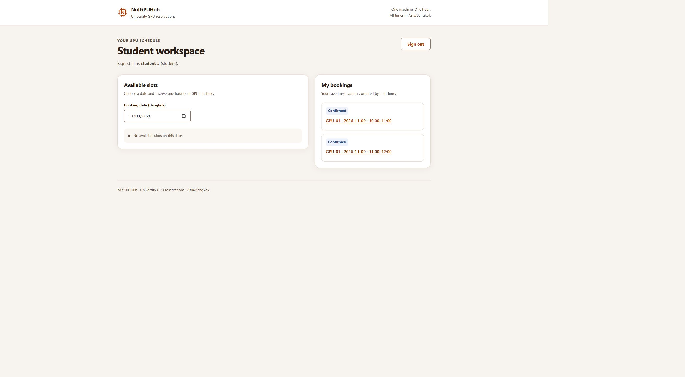

# BUG-01 Development Proxy Verification

Issue [#24](https://github.com/Kawi-HBLI/NutGPUHub/issues/24) supports QA-01 #16. Tanadet implements and Thawat reviews. Checks ran on November 8, 2026, on `fix/vite-api-proxy`, based on the accepted UI merge `cb8b5a9297beac523549ae35a2e2fe17a9613af4`. The linked PR identifies the resulting implementation commit; these checks ran on the same source tree before that commit.

## Reproduction and fix

Vite matches proxy prefixes before transforming client modules. The `/api` rule also matches `/api.ts`, imported by the React entry point. That module was sent to the backend instead of being served as JavaScript. The built-server browser tests do not exercise Vite module loading.

The fix narrows the prefix to `/api/`. No application handlers, database schema, dependencies or existing E2E assertions changed.

## Repeatable regression check

Run `npm run verify:dev`, or run it as part of `npm test`. TC-DEV-01 loads the real project Vite configuration and keeps its proxy matching keys. Only destinations are replaced with an isolated HTTP backend; both backend and Vite middleware are hosted on loopback OS-assigned ports. Dependency prebundling and HMR are disabled for this HTTP routing check. It needs no database, password or saved configuration and closes its own servers.

| Request | Original prefix | Fixed prefix |
|---|---|---|
| `/` | 200 HTML | 200 HTML with the client entry |
| `/main.tsx` | 200 JavaScript | 200 JavaScript importing `/api.ts` |
| `/api.ts` | 404 JSON from the isolated backend; assertion fails | 200 JavaScript exporting `apiRequest` |
| `/api/v1/auth/me` | Not reached after the failing module assertion | 401 JSON with the isolated backend marker |

The successful run also asserts that the backend received exactly `/api/v1/auth/me`; no client module was proxied. The red run was reproduced with the original prefix and the same final regression test, then the fix was restored and the check passed. This is routing regression evidence, not a replacement for the genuine TC-BOOK-02/04 domain-rule TDD evidence.

## Actual development browser check

The actual Vite CLI ran on `http://localhost:5173`, with the real application API on loopback port 3000 and the isolated synthetic preview database. The page rendered, `student-a` signed in, the Student workspace retrieved its saved bookings, and Sign out returned to the sign-in form. No error-level browser logs were observed at the workspace check. No production account or database was used.

Figure 1. TC-DEV-01 manual companion check. Role: synthetic student. Starting state: signed out at the development URL. Steps: load the page and sign in with prepared local credentials. Expected: JavaScript modules load and authenticated API requests return the student's workspace and saved reservations. Actual: the workspace and two existing synthetic bookings were shown. Sign-out was verified separately in the live browser. This image is not a final-release booking demonstration.

## Recorded results and remaining work

- `npm run verify:dev`: passed; original-prefix rerun failed with `404 !== 200` as expected.
- `npm test`: 36 passed, 0 failed, 0 skipped; 7 files. The smoke check also passed while the actual Vite preview was running.
- `npm run build`: both TypeScript configurations and Vite passed.
- `npm run test:e2e`: both existing built-server browser journeys passed unchanged.
- Raw red/green, build/test/browser output, development-server logs and the synthetic screenshot are retained locally under ignored `evidence/vite-proxy/`.

QA-01 #16 remains open for peer-accepted final-candidate checks, clean-checkout setup, captioned Part F demonstrations and the domain-rule/access-restriction evidence. Historical F-03 red/green files were inventoried locally; inventory alone does not mark those submission requirements complete.
